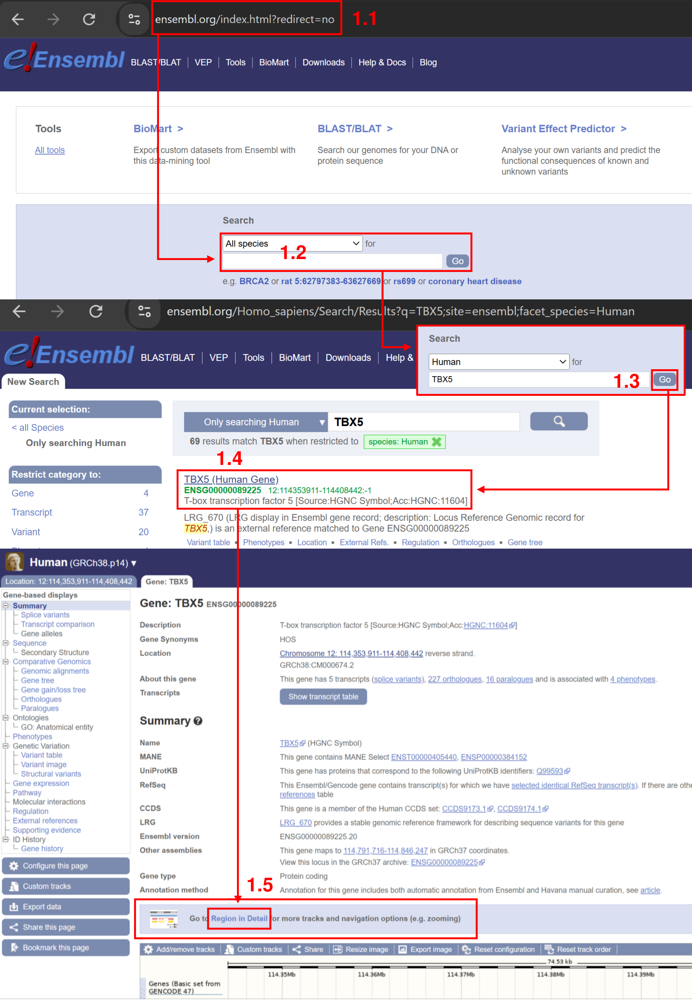
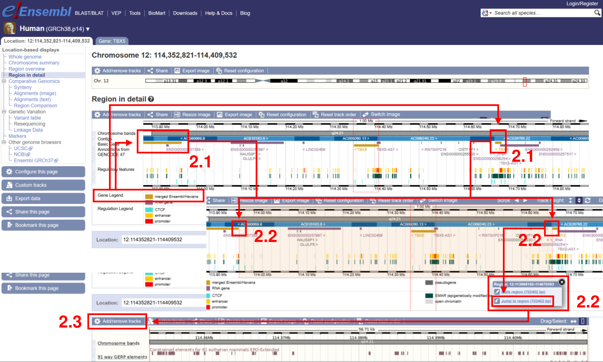
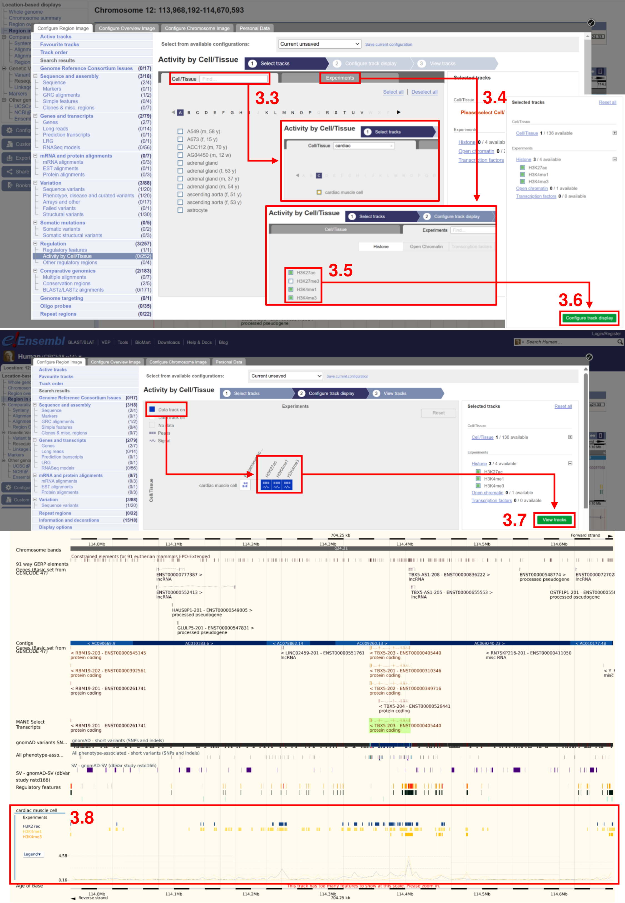
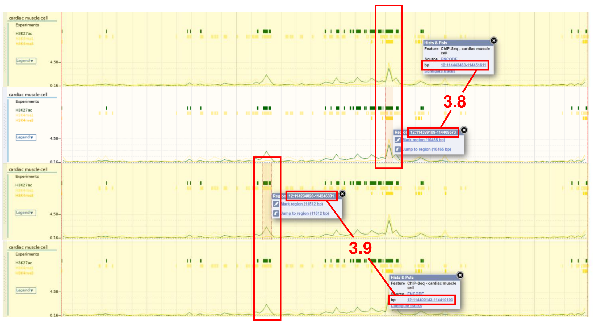
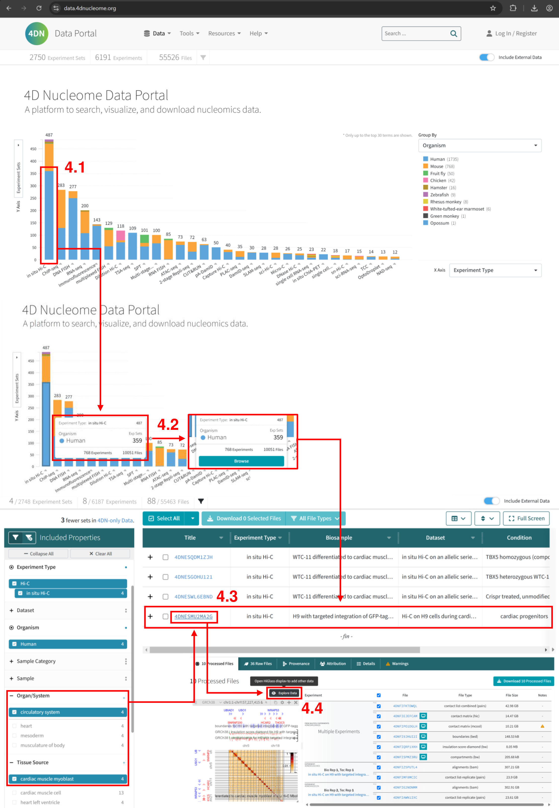

# EnhancerWorkflow -  A workflow to screen enhancers using cis-regulatory elements (CREs)

## Description

A workflow for screening/selecting gene-associated enhancers based on cis-regulatory elements (CREs) and comparative genomics.

Manuscript: Jooa Kwon, George Z. He, Hieu T. Nim<sup>\*</sup>, Mirana Ramialison<sup>\*</sup>. "A Web-Based Workflow for Selecting Gene- and Tissue
Specific Enhancers". (<sup>\*</sup>: corresponding authors)

## Fork the project

To get the source code, please click the "fork" button in the upper-right and then add this repo as an upstream source:

```
git clone https://github.com/<your-username>/EnhancerWorkflow.git
cd EnhancerWorkflow
git remote add upstream https://github.com/Ramialison-Lab/EnhancerWorkflow.git
```

To get sync new content, use:

```
git pull upstream main
```

## An example execution of the protocol &#8212; heart-relevant <i>TBX5</i> enhancers
This describes the protocol with schematics below, which uses a heart-oriented example, with heart-related datasets and the <i>TBX5</i> gene, which is relevant to heart development.

### Step 1 &#8212; Find the gene of interest on the EnsEMBL genome browser

Define the genomic region in which enhancers may be found, using the gene of interest. In this case, it is <i>TBX5</i>, an important developmental gene during organogenesis.

On the EnsEMBL genome browser, the human transcript of the gene-relevant <i>TBX5</i> gene was loaded:

1. The EnsEMBL genome browser was loaded.
2. The search bar was used to search for regions including the <i>TBX5</i> gene.
3. The species-specific search field was populated, to ensure the correctness of search entries.
4. The human transcript for the <i>TBX5</i> gene was loaded.
5. A more detail view of the region surrounding the gene of interest was loaded using the "Region in detail" view.



### Step 2 &#8212; Define the enhancer detection region on the EnsEMBL genome browser

On the EnsEMBL genome browser, the enhancer detection region surrounding the human <i>TBX5</i> gene was defined:

1. The two flanking genes adjacent to <i>TBX5</i>, were identified using basic gene annotations on the GENCODE track. The directionality of <i>TBX5</i> was determined using the < symbol next to its name under the yellow element in the GENCODE track. This was used later to determine upstream regions of <i>TBX5</i>.
2. The intergenic region between the two flanking genes on the left and right of <i>TBX5</i> was selected by clicking and dragging.



### Step 3 &#8212; Analyse H3K4me1 and H3K27ac histone marks to screen for active <i>TBX5</i> enhancers

On the EnsEMBL genome browser, the enhancer detection region surrounding the human <i>TBX5</i> gene was examined using histone mark data to establish regions associated with enhancer activity:

1. The page showing the region surrounding <i>TBX5</i> in detail was configured to add data tracks show epigenetic data related to the tissue of interest.
2. Datasets were located using the sidebar, which group options under "Regulation" and "Activity by Cell/Tissue".
3. The heart tissue-specific dataset, "cardiac muscle cell", was loaded using the Cell/Tissue search bar.
4. Data for specific epigenetic experiments were loaded.
5. H3K4Me1 data was selected as the marker for enhancers. H3K27ac data was selected to mark active enhancers. H3K4me3 data was selected to mark promoters, to gauge promoter-enhancer interactions.
6. The new epigenetic data tracks were added to the genome browser.
7. The added tracks for H3K4Me1, H3K27ac, H3K4me3 data for cardiac muscle cells were viewable as new additions in the data tracks section.



8. The genomic coordinates of the overlap between H3K4Me1 and H3K27ac data peaks (signifying active enhancers) in their respective tracks were recorded using the coloured box elements in the H3K4Me1 track. The coordinates were found by clicking on the element and extracting the coordinates that were displayed next to "bp".
9. The process of obtaining the genomic coordinates was repeated for the promoter using the H3K4me3 data track.



### Step 4 &#8212; Use Hi-C datasets to further filter <i>TBX5</i> enhancers from the EnsEMBL genome browser

Verify the interactions between promoters and active enhancer regions obtained from the EnsEMBL genome browser, to experimental epigenetics datasets online.

In the case of this walkthrough, since the gene of interest is <i>TBX5</i>, an important developmental gene during organogenesis, a cardiac progenitor cell dataset will be used for verification.

The link to the Hi-C dataset used can be found [here](https://data.4dnucleome.org/experiment-set-replicates/4DNESMU2MA2G).

On the 4D Nucleome data portal (4DN):

1. The data portal was loaded.
2. Human experiment sets containing <i>in situ</i> Hi-C data were selected for comparison.
3. The human <i>in situ</i> Hi-C datasets were filtered to find datasets related to the tissue of interest. The best dataset was loaded by clicking the link to the data in its Hi-C experiment set.
4. Processed files in the Hi-C dataset were explored using 4DN's heatmap (matrix) data viewer.



5. The genomic coordinates of the <u>promoter</u> of <i>TBX5</i>, obtained from the EnsEMBL genome browser, was input into the search bar at the top of the matrix viewer. The boundaries of the coordinates were marked by adding <u>horizontal</u> lines. The field of view on the matrix viewer was adjusted vertically to some degree, so that the upper and lower bounds in the Y-coordinates of the matrix viewer's coordinate search bar aligned with the promoter's genomic coordinates. This allowed the region to be tracked across the matrix, which represented interactions within the whole genome.
6. The genomic coordinates of control enhancers of <i>TBX5</i> defined in the literature ([Smemo et al., 2012](https://pubmed.ncbi.nlm.nih.gov/22543974/)), were marked by adding <u>vertical</u> lines.  These vertical lines marked the were defined on the 4DN matrix in the same way. Sometimes, new lines were inadvertently added. To fix this, right clicking the line and selecting "remove horizontal or vertical rule" removed the line.
7. The boxed regions that defined regions of interactions between control enhancers and the <i>TBX5</i> promoter were visualised due to the intersecting horizontal (promoter boundaries) and vertical (enhancer boundaries) lines on the matrix. An interaction threshold within the boxed regions was determined using the colour key on the right side of the matrix viewer. The lowest non-zero interaction score using the colour key was used to verify interactions between putative enhancers and the <i>TBX5</i> promoter region, obtained from EnsEMBL retrieval.
8. Genomic coordinates of putative enhancers from EnsEMBL were marked in the 4DN matrix. Interaction thresholds between putative and control enhancers, to the promoter, were compared. Higher putative activity, based on a higher interaction threshold, verified the active enhancer regions obtained from the EnsEMBL genome browser.


##
### References:
Smemo, S., Campos, L. C., Moskowitz, I. P., Krieger, J. E., Pereira, A. C., Nobrega, M. A. Regulatory variation in a TBX5 enhancer leads to isolated congenital heart disease. Hum Mol Genet. 21 (14), 3255-3263 (2012)
